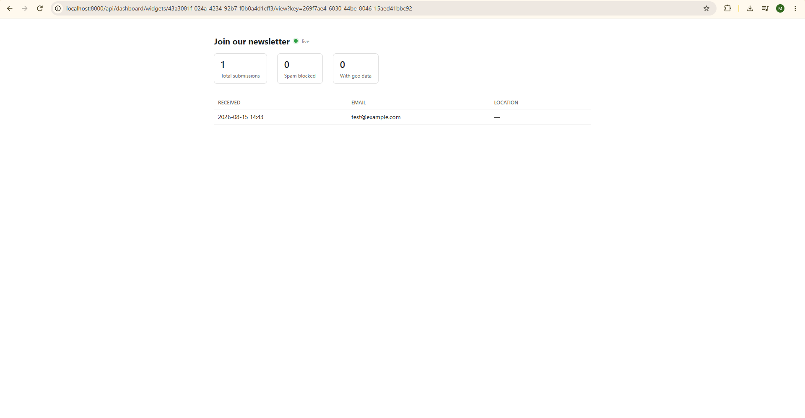

# Embeddable Widget & Lead-Capture Platform

FlyRank Backend Track capstone. Lets a tenant define a widget (signup form or
CTA popover), embed it anywhere with one `<script>` tag, and safely collect,
protect, enrich, and dashboard every submission from the open internet.

Full design rationale: see [`DESIGN.md`](./DESIGN.md).

## Status

- [x] Phase 1 — Design doc
- [x] Phase 2 — Hardened submission path (validation, CORS, rate limiting,
      honeypot, geo fallback chain, safe email side effect)
- [x] Phase 3 — Delivery, dashboard & proof (versioned bundle, embed snippet,
      multi-tenant isolation tests, live two-origin end-to-end run) — 24/24
      tests green
- [x] Phase 4 — Demo prep (rehearsed script in `DEMO.md`, `/demo/*` toggle
      endpoints so probes 4/5 can be triggered live without a restart)

## Stretch goals (§9)

- [x] Minimal HTML dashboard view — server-rendered, no build step, XSS-escaped
- [x] Real-time dashboard — new submissions appear live via Server-Sent Events
- [x] Bot defense — proof-of-work challenge, measured spam reduction (see
      `EVIDENCE.md`): naive bots 100% blocked, legitimate visitors 0% false
      positives, ~117ms average solve cost per real submission

Suite is at 47/47 (`pytest -q`).

## Architecture

```
Widget Owner (authenticated)
 └─► Widget Management API ─► Widget DB (tenant-isolated) ─► embed snippet

Customer Website (any origin)
 └─ <script src="widget.js?id=123">
    └─► GET /widgets/:id/config (public · cached · CORS)
    └─► render widget

Website Visitor
 └─► POST /submissions (public · CORS)
      ├─► validation ── bad payload? → 4xx, never 500
      ├─► rate limit + spam check ── flood? → 429, service stays up
      ├─► geo enrichment: Provider A ─(fails)─► Provider B ─(fails)─► store anyway
      ├─► store submission
      └─► email/webhook side effect (failure must NOT block success)

Widget Owner (authenticated)
 └─► Dashboard API ◄── submissions + stats
```

## Setup

```bash
git clone <this repo>
cd flyrank-capstone-widget-platform
python -m venv .venv && source .venv/bin/activate   # Windows: .venv\Scripts\activate
pip install -r requirements.txt
cp .env.example .env
python -m app.seed
uvicorn app.main:app --reload
```

Note the widget id printed by the seed step — you'll need it for the test page below.

Run the tests:

```bash
pytest -q
```

## Try the second-origin flow yourself

```bash
# terminal 1 (repo root, venv active)
uvicorn app.main:app --reload

# terminal 2
cd test-site
python -m http.server 5500
```

Open `test-site/index.html` in the URL it prints, after replacing
`PASTE_WIDGET_ID_HERE` in that file with the id the seed step printed. The
widget renders on a page served entirely from a different port than the API —
inspect the network tab to see the cross-origin config fetch and submission.

## Owner dashboard (plain HTML, no build step)

## Dashboard  
  
 


```
http://localhost:8000/api/dashboard/widgets/{widget_id}/view?key={api_key}
```

Server-rendered submissions table with basic stats. All submission data is
HTML-escaped before rendering (a visitor's form input is untrusted, so this
is the one place a stored-XSS bug could live — see
`tests/test_dashboard_view.py::test_dashboard_view_escapes_submission_data`).

New submissions appear on this page live, via Server-Sent Events — no
refresh needed. Open the dashboard URL in one tab, submit the widget from
`test-site/index.html` in another, and watch the row animate in.

## Limitations

- Rate limiting is in-process/in-memory — correct for this single-instance
  capstone (proven by `test_burst_triggers_429_then_service_recovers`), but a
  multi-instance deployment would need a shared store (Redis) instead.
- API-key auth only, no session/JWT login flow — sufficient for the brief's
  "authenticated admin API" requirement, not meant as a production auth system.
- Password hashing is a plain SHA-256, not bcrypt/argon2 — fine for a local
  demo, not something to ship.
- Geo enrichment providers are called live in dev; tests use the
  `FORCE_DOWN_A`/`FORCE_DOWN_B` toggles in `app/services/geo.py` for
  deterministic fallback testing, per the brief's §3 constraint.

See `EVIDENCE.md` for what's proven per checkbox and `BUILDLOG.md` for how AI
was used at each phase.
